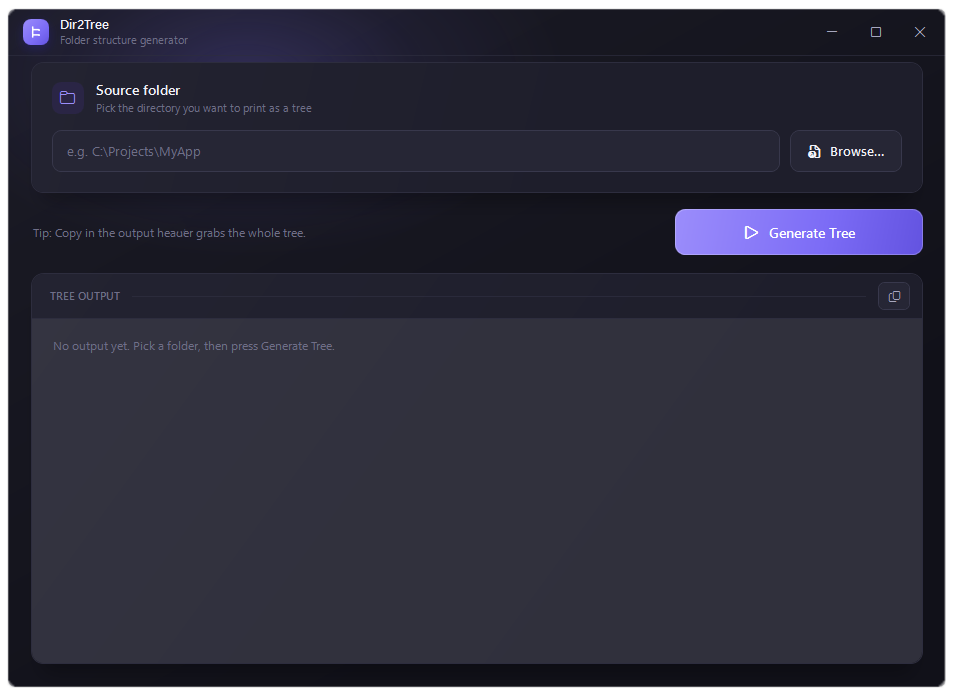

<div align="center">
  
  <h1>dir2tree</h1>
  <p>
    <strong>A lightweight Windows WPF utility for generating clean, copy-ready ASCII/Unicode directory trees.</strong>
  </p>
  <p>
    
    
    
    
  </p>
</div>

---

## Overview

**dir2tree** turns any local folder into a structured, readable directory tree using Unicode box-drawing characters (`├──`, `└──`, `│`). It is built for developers, technical writers, and anyone who needs to paste project structures into documentation, READMEs, issues, or AI prompts without manual formatting.

<p align="center">
  
</p>

## Features

- **Clean Unicode Tree Output** — Formats folders with trailing `/` and sorts directories and files alphabetically.
- **Smart Noise Filtering** — Automatically ignores common IDE, build, dependency, cache, and OS artifacts so your tree stays focused on source files.
- **Large-Directory Summarization** — Directories with more than 20 files are automatically summarized by file extension (e.g., `[42 files: 25 .cs, 12 .xaml, 5 .png]`) instead of flooding the output.
- **One-Click Clipboard Copy** — Copy the generated tree directly to the Windows clipboard.
- **Persistent Path Memory** — Remembers your last used directory across sessions.
- **Graceful Permission Handling** — Restricted folders are marked as `[Access Denied]` without interrupting the rest of the scan.
- **Custom Dark UI** — Frameless dark-themed WPF interface with a custom title bar.

## Example Output

```text
dir2tree/
├── Properties/
│   ├── AssemblyInfo.cs
│   ├── Resources.Designer.cs
│   ├── Resources.resx
│   ├── Settings.Designer.cs
│   └── Settings.settings
├── Themes/
│   ├── Colors.xaml
│   └── Controls.xaml
├── UI/
│   ├── TitleBar.xaml
│   └── TitleBar.xaml.cs
├── docs/
│   └── screenshot.png
├── App.config
├── App.xaml
├── App.xaml.cs
├── LICENSE.txt
├── MainWindow.xaml
├── MainWindow.xaml.cs
├── Readme.md
├── dir2tree.csproj
└── dir2tree.sln
```

## Default Ignored Patterns

`dir2tree` skips the following directories, files, and wildcard patterns (case-insensitive):

| Category | Ignored Entries |
| --- | --- |
| **IDE & Editors** | `.idea`, `.vscode`, `.vs` |
| **Python** | `.venv`, `venv`, `__pycache__`, `*.pyc`, `*.pyo`, `*.egg-info` |
| **Node.js** | `node_modules`, `.next` |
| **.NET** | `bin`, `obj`, `packages` |
| **Git** | `.git`, `.gitignore` |
| **Build & Cache** | `dist`, `build`, `.cache` |
| **OS Artifacts** | `.DS_Store`, `Thumbs.db`, `desktop.ini` |
| **Logs** | `*.log` |

## Getting Started

### Prerequisites

- **OS:** Windows 10 / 11
- **Runtime:** [.NET Framework 4.7.2](https://dotnet.microsoft.com/en-us/download/dotnet-framework/net472) or later
- **Build Tools (for building from source):** Visual Studio 2019/2022 (with `.NET desktop development` workload) or MSBuild

### Build from Source

1. Clone the repository:
   ```bash
   git clone https://github.com/your-username/dir2tree.git
   cd dir2tree
   ```
2. Open `dir2tree.sln` in Visual Studio, or build from the command line with MSBuild:
   ```powershell
   msbuild dir2tree.sln /p:Configuration=Release
   ```
3. Run the compiled executable from `bin\Release\dir2tree.exe` (or `bin\Debug\dir2tree.exe`).

## Usage

1. Launch **dir2tree**.
2. Click **Browse** to select a target folder (or paste a directory path directly into the input box).
3. Click **Generate** to build the tree structure.
4. Click **Copy** to copy the output to your clipboard.

## Project Structure

```text
dir2tree/
├── Properties/          # Assembly metadata, resources, and user settings
├── Themes/              # Dark theme color palette and control styles
├── UI/                  # Custom window title bar component
├── docs/                # Documentation assets (screenshots)
├── App.xaml(.cs)        # Application entry point and resource dictionaries
├── MainWindow.xaml(.cs) # Main UI layout and tree generation logic
├── dir2tree.csproj      # .NET Framework 4.7.2 WPF project file
└── dir2tree.sln         # Visual Studio solution file
```

## License

This project is licensed under the **MIT License** — see the [LICENSE.txt](LICENSE.txt) file for details.
